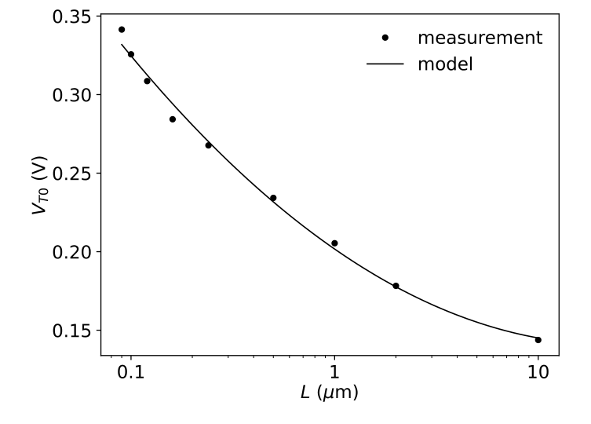
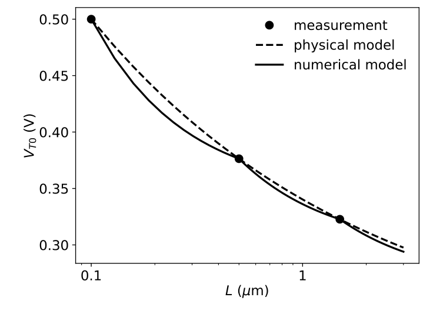
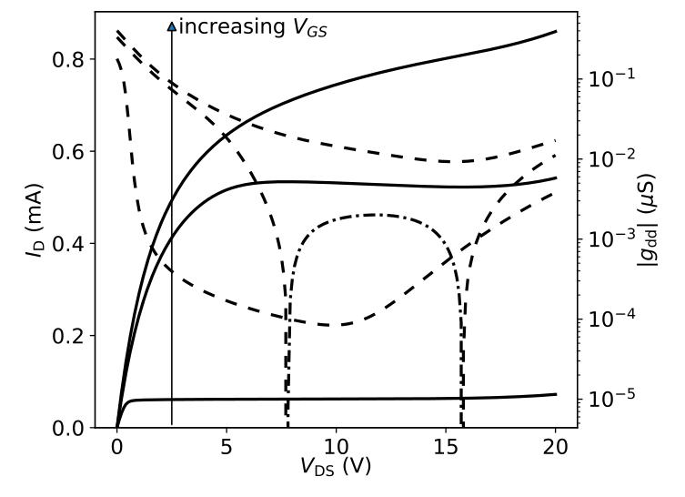
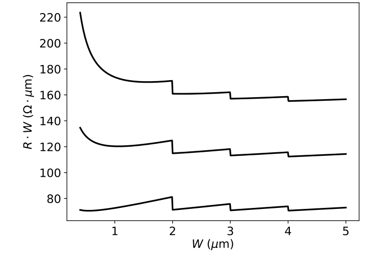
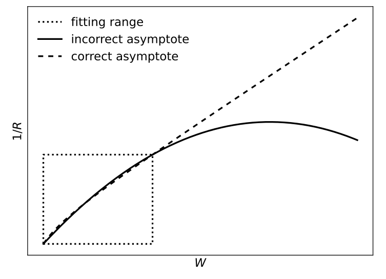
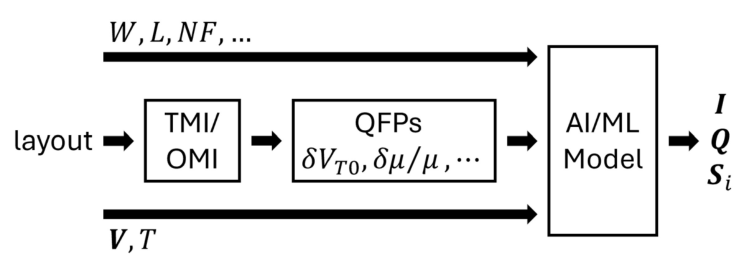
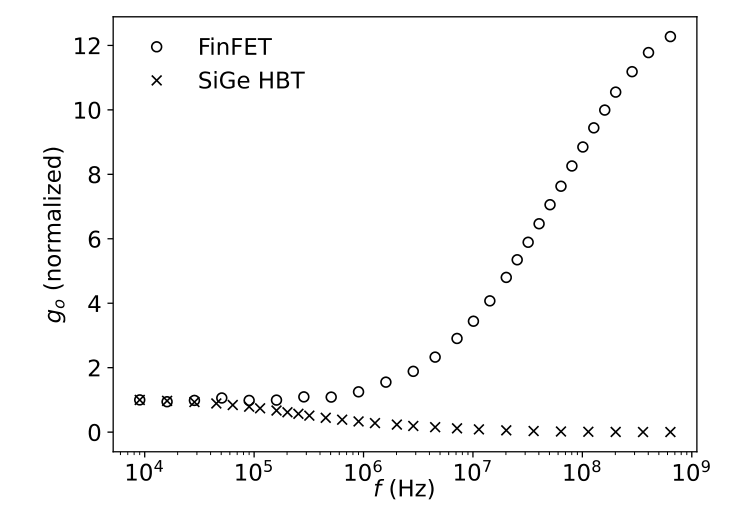
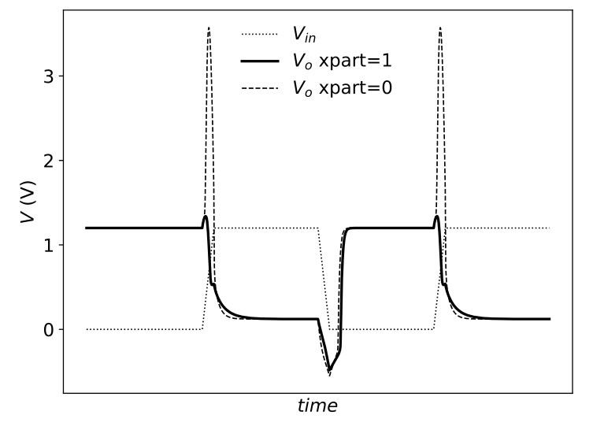

# Benchmarks for SPICE Modeling and Parameter Extraction Based on AI/ML

## Bibliographic information

| Field | Value |
|-------|-------|
| Title | Benchmarks for SPICE Modeling and Parameter Extraction Based on AI/ML |
| Authors | Colin C. McAndrew, Andries J. Scholten, Kiran K. Gullapalli, Yogesh Chauhan, Kejun Xia |
| Affiliations | Colin C. McAndrew (NXP Semiconductors N.V., Chandler, AZ, USA; Iowa State University, Ames, IA, USA — Corresponding author); Andries J. Scholten (NXP Semiconductors N.V., Eindhoven, The Netherlands); Kiran K. Gullapalli (NXP Semiconductors N.V., Austin, TX, USA); Yogesh Chauhan (Indian Institute of Technology Kanpur, Kanpur, India); Kejun Xia (Taiwan Semiconductor Manufacturing Company (TSMC), Hsinchu, Taiwan) |
| Venue | IEEE Transactions on Electron Devices (IEEE TED) |
| Venue type | journal |
| Year | 2025 |
| Volume / issue / pages | Vol. 72, No. 4, pp. 1551–1559 (April 2025) |
| Paper DOI | [https://doi.org/10.1109/TED.2025.3537952](https://doi.org/10.1109/TED.2025.3537952) |
| arXiv | |
| URL | [https://doi.org/10.1109/TED.2025.3537952](https://doi.org/10.1109/TED.2025.3537952) |
| Keywords | Artificial neural network (ANN) modeling, compact modeling, parameter extraction, SPICE, layout-dependent effects (LDE), non-quasi-static (NQS), Gummel symmetry, quality assurance |
| Open access | IEEE Xplore Open / Hybrid |

**PDF:** [paper.pdf](./paper.pdf)

Digital Object Identifier: 10.1109/TED.2025.3537952  
Received 25 November 2024; revised 29 January 2025; accepted 30 January 2025. Date of publication 13 February 2025; date of current version 28 March 2025. Review arranged by Editor F. Bonani.

## TL;DR

- Machine learning (ML) and artificial neural network (ANN) approaches for compact modeling and SPICE parameter extraction have proliferated, but overwhelmingly rely on synthetic TCAD or compact-model simulation data while failing to model real hardware measurements.
- Published AI/ML models routinely omit fundamental physical requirements: Gummel symmetry, passivity, thermodynamics, monotonicity, asymptotic behavior ($V \to \infty, -\infty$), and continuity in higher-order derivatives.
- Modern advanced-node phenomena—specifically layout-dependent effects (LDEs via TMI/OMI), dynamic self-heating ($g_{ds}(f)$), non-quasi-static (NQS) charge response, statistical variation/mismatch, and aging—are virtually unaddressed in ML modeling literature.
- The authors formulate authoritative, CMC-aligned benchmark checklists (Table I for models, Table II for parameter extraction) establishing the baseline criteria required for AI/ML device models to transition from academic prototypes to industrial-strength SPICE deployment.

## Problem statement

Over recent decades, academic literature on AI/ML-based compact modeling and parameter extraction has grown rapidly. However, nearly all published works evaluate proposed techniques exclusively on synthetic data (generated from physics-based compact models like BSIM or TCAD grids) under clean, idealized conditions. They do not demonstrate fitting to real measured hardware data containing statistical wafer-level noise, parasitic shifts, and measurement artifacts. Furthermore, authors rarely evaluate whether their numerical surrogates adhere to foundational device physics: passivity, conservation of energy, thermodynamic limits, asymptotic correctness outside training ranges, continuous higher derivatives ($g_m, g_{ds}, g_{m2}, g_{m3}$), and layout-dependent variations. Consequently, while these AI/ML models appear successful on simple $R^2$ or RMS error metrics, they suffer from fatal non-convergence, unphysical oscillations, and simulation failures when instantiated in standard circuit simulators.

## Motivation

Physically based compact models (standardized by the Compact Model Coalition, CMC) require years or decades to formulate and integrate into SPICE engines, frequently lagging behind advanced semiconductor technology nodes (nanosheet GAAFETs, CFETs, high-voltage LDMOS, and SiGe HBTs). Numerical and ML-based models promise rapid turnaround: given characterization data, neural networks can approximate multi-dimensional constitutive relations without hand-crafted physics equations. However, commercial circuit design and sign-off demand absolute reliability across massive temperature, bias, frequency, and statistical corners. Unless AI/ML compact models satisfy rigorous physical benchmarks and interface seamlessly with industry EDA standards (e.g., Verilog-A, OMI, TMI), they cannot be deployed in production IC design flows.

## Prior art

Historically, device modeling is divided into physical models (CMC standards such as BSIM3/4, BSIM-CMG, PSP, HiSIM, MEXTRAM, HICUM) and numerical/table-based models (widely adopted in RF/microwave design, e.g., Root models, Cardiff model). Table-based numerical methods (e.g., [6]–[9]) offer fast evaluation but struggle with multi-dimensional scaling (geometry, temperature, bias) and lack inherent physical constraints. Recent AI/ML works (e.g., [10]–[17]) train multi-layer perceptrons or deep neural networks to emulate MOSFET $I$-$V$ or parameter extraction steps. However, prior art universally falls short in: (1) handling noisy, non-ideal silicon measurements; (2) guaranteeing derivative smoothness; (3) ensuring passive elements remain passive; (4) incorporating layout-dependent effects (LDEs); and (5) modeling dynamic self-heating and non-quasi-static (NQS) charge dynamics.

## Category of work

Primary: `circuit-theory`  
Secondary: `compact-modeling`  
Note: Standardized benchmarking criteria, physical verification requirements, and quality-assurance guidelines for AI/ML-based SPICE compact modeling and parameter extraction.

## Method / approach

The authors establish a formal benchmarking methodology based on the institutional experience of CMC model developers and foundry parameter extraction teams. The framework is structured into comprehensive checklists and physical tests:

1. **Basic Physical Consistency:**
   - Obey basic physical laws: passive elements (resistors, capacitors, inductors) must be passive ($R > 0$, positive energy dissipation).
   - Obey thermodynamic principles: no generation of power in passive bias regimes ($\oint i \, dv \le 0$).
   - Gummel symmetry test (GST): complete symmetry for symmetric devices with odd/even derivative parities around $V_{ds} = 0$.
2. **Real Hardware Data & Non-Idealities:**
   - Must fit measured silicon data (not just synthetic TCAD or compact-model curves).
   - Must handle local statistical variation (wafer-level noise) without overfitting unphysical wiggles.
3. **Smoothness, Monotonicity, and Derivatives:**
   - Monotonicity in primary output variables ($I_{ds}$ vs. $V_{gs}$, $I_{ds}$ vs. $V_{ds}$, $V_{th0}$ vs. $L$).
   - Continuity and smoothness in 1st, 2nd, and 3rd derivatives ($g_m, g_{ds}, g_{m2}, g_{m3}$), critical for RF intermodulation and analog distortion.
   - Preserving true physical non-monotonicities: e.g., negative output conductance ($g_{ds} < 0$) in LDMOS quasi-saturation and self-heating, or contact-count step discontinuities in integrated resistor $R \cdot W$ vs. $W$.
4. **Asymptotic Correctness:**
   - Numerical surrogates must exhibit correct asymptotic behavior as biases or dimensions extrapolate to extreme limits (e.g., $W \to 0 \implies 1/R \to 0$, $V_{gs} \to -\infty \implies I_{ds} \to 0$ exponentially rather than oscillating or turning upward).
5. **Advanced Node Physical Effects:**
   - **Layout-Dependent Effects (LDEs):** Must interface with industry standard Technology Modeling Interface (TMI) or Open Model Interface (OMI) to consume Quasi-Fermi Potential / parameter perturbations based on complex layout context (STI stress, WPE).
   - **Self-Heating:** Dynamic frequency-dependent thermal network yielding thermal impedance $Z_{th}(j\omega)$, explaining $g_{ds}(f)$ transitions.
   - **Non-Quasi-Static (NQS) Dynamics:** Proper charge partitioning and relaxation-time approximations (RTA) to prevent unphysical transient current spikes without destroying AC capacitance reciprocity.
   - **Noise & Statistical Variation:** Thermal, flicker ($1/f$), and shot noise formulations, combined with global corners and mismatch modeling.
6. **Implementation & EDA Integration:**
   - Standard Verilog-A implementation with analytic or auto-differentiated Jacobians.
   - Benchmarking simulation speed, Newton-Raphson iteration counts, and convergence robustness in basic circuit blocks (inverter, ring oscillator, OTA).

## Experimental setup

The paper synthesizes empirical data and benchmark case studies across multiple commercial semiconductor technologies:
- **90-nm CMOS:** Measured threshold voltage $V_{th0}$ vs. channel length $L$ across wafer sites, exhibiting raw statistical scatter.
- **0.18-$\mu$m BiCMOS:** Integrated resistor arrays characterizing normalized resistance $R \cdot W$ vs. width $W$ across process corners, revealing discrete contact-step discontinuities and correct asymptotic conductance ($1/R \to 0$ as $W \to 0$).
- **High-Voltage / LDMOS Transistors:** Measured $I_D$–$V_{DS}$ and output conductance $g_{dd}$, demonstrating real physical negative output conductance ($g_{dd} < 0$) due to quasi-saturation and self-heating.
- **FinFET & SiGe HBT Technologies:** High-frequency $S$-parameter measurements extracting normalized output conductance $g_o(f)$ across frequency ($1\text{ kHz}$ to $10\text{ GHz}$), illustrating thermal relaxation pole dynamics.
- **Standard Inverter Circuit Simulation (BSIM4):** Transient simulation benchmarking charge partitioning ($xpart = 0$ vs. $xpart = 1$) under ultra-fast input edges, highlighting NQS transient current spikes.

## Results summary

The paper details how standard AI/ML approaches fail when tested against these criteria and provides exact quantitative guidelines:
- **Fitting Scatter vs. Physics:** Fitting raw measured $V_{th0}(L)$ with unconstrained high-capacity ML models captures local wafer-level noise, producing non-monotonic humps that corrupt short-channel design. Physical models yield smooth, strictly monotonic roll-off.
- **Resistor Asymptotics:** Naive linear or polynomial regressions of resistor conductance produce non-zero intercepts at $W = 0$, violating the physical boundary condition that zero-width resistors have zero conductance ($1/R \to 0$).
- **Frequency-Dependent Self-Heating:** In FinFETs and SiGe HBTs, $g_o(f)$ undergoes a massive qualitative shift between DC/low-frequency ($g_o$ dominated by self-heating) and RF frequencies ($g_o$ dominated by pure electronic conductance). Static ML models fail completely across this transition.
- **Transient Inverter Spikes:** Pure quasi-static ML models produce massive, unphysical displacement current spikes during transient switching, proving that static charge mapping is insufficient for dynamic SPICE simulation.

## Contributions

- Formulated the first comprehensive, CMC-aligned industry benchmark checklists for AI/ML-based SPICE compact modeling (Table I) and parameter extraction (Table II).
- Identified critical blind spots in current academic AI/ML modeling literature, specifically the over-reliance on synthetic TCAD data and the neglect of derivative smoothness, passivity, and asymptotics.
- Detailed the mandatory physical requirements for modern nodes: layout-dependent effects (TMI/OMI), dynamic self-heating, non-quasi-static charge response, and wafer-level statistical variation.
- Established standards for numerical implementation, simulator convergence benchmarking, and open-source reproducibility to advance AI/ML models toward industrial viability.

## Innovations

- Systematized the tension between fitting non-ideal silicon measurements (wafer-level statistical noise) and maintaining strict physical monotonicity.
- Codified boundary conditions for both physical non-monotonicities (LDMOS quasi-saturation, resistor contact quantization) and mathematical smoothness.
- Established the requirement that numerical/surrogate models must integrate with TMI/OMI black-box layout-dependent parameter perturbation frameworks.

## Limitations and future work

- The authors provide benchmark specifications and guidelines rather than proposing a specific neural network architecture or open-source software library.
- Concrete quantitative error thresholds (e.g., maximum allowable tolerance on $g_{m3}$ or $Z_{th}(\omega)$) are left to specific foundry-customer agreements and CMC working group specifications.
- Future work must focus on developing physics-informed neural network (PINN) architectures and automated verification toolchains that systematically enforce these checklists.

## Research opportunity

- **Automated Physical QA Toolchains:** An urgent need exists for automated software tools that ingest candidate Verilog-A neural models, compile them via modern open compilers (e.g., OpenVAF), and automatically run GST, derivative checks, NQS transients, and TMI stress tests.
- **Physics-Informed Architectures:** Developing neural network architectures with hard-coded Gummel symmetry (odd/even parity), guaranteed monotonic subthreshold roll-off, and energy-conserving multi-port transcapacitance matrices.
- **Automated Parameter Extraction Pipelines:** Implementing ML extraction frameworks that optimize physical parameters with guaranteed parameter-bound feasibility and sensitivity-aware multi-objective losses.

## Pros and cons

### Pros

- Authored by world-renowned compact modeling leaders (IEEE Fellows, CMC contributors, foundry and EDA veterans from NXP, TSMC, IIT Kanpur, and Iowa State).
- Extremely timely and pragmatic; cuts through exaggerated claims in AI/ML literature by grounding evaluations in production semiconductor realities.
- Highlights essential high-frequency and advanced-node phenomena (LDEs, dynamic self-heating, NQS) that standard ML papers completely overlook.
- Provides clean, structured checklists that can serve as formal unit-test suites for EDA developers.

### Cons

- Does not release an accompanying open-source benchmarking codebase or automated testing harness in this paper.
- Focuses primarily on MOSFET, FinFET, LDMOS, and resistor examples; detailed RF bipolar (HICUM/MEXTRAM) and cryogenic modeling specifics are only briefly touched upon.
- Analysis: Foundries may find some guidelines challenging to quantify without standardized synthetic golden benchmarks.

## Benchmarks and tables

### Table I: CHECKLIST FOR MODELS

Source: Page 2.  
Description: Comprehensive evaluation checklist of mandatory criteria for AI/ML-based compact models.

| Category | Requirement / Benchmark Item | Critical Evaluation Criteria |
|:---|:---|:---|
| Basics | Pass basic checks | Gummel symmetry, passivity of passive elements, 1st and 2nd laws of thermodynamics |
| Measured Data | Fit to measured data | Evaluate on real silicon measurements, not exclusively synthetic TCAD or compact models |
| Accuracy | Detailed error metrics | RMS error, maximum error, error distributions across bias, geometry, and temperature |
| Non-Ideal Data | Robustness to imperfections | Filter wafer-level scatter and measurement noise without creating unphysical humps |
| Smoothness | Monotonicity & derivatives | Monotonic $I_{ds}(V_{gs})$, $I_{ds}(V_{ds})$, $V_{th0}(L)$; continuous 1st, 2nd, and 3rd derivatives ($g_m, g_{ds}, g_{m2}, g_{m3}$) |
| Physical Nonmonotonicity | Preserve physical anomalies | Accurately capture true negative $g_{ds}$ (LDMOS quasi-saturation) and resistor contact steps |
| Asymptotics | Extreme-value bounds | Physically correct asymptotic behavior as $V \to \pm\infty$, $W \to 0$, $L \to 0$ |
| LDEs | Layout-dependent effects | Compatibility with Si2 CMC Open Model Interface (OMI) and foundry TMI frameworks |
| Self-Heating | Thermal impedance dynamics | Frequency-dependent output conductance $g_o(f)$ and dynamic temperature rise |
| Noise | Stochastic modeling | Accurate thermal, flicker ($1/f$), and shot noise across bias and geometry |
| NQS | Non-quasi-static dynamics | Relaxation-time approximation (RTA) preventing unphysical transient current spikes |
| Statistics & Aging | Variability & reliability | Global process corners, local mismatch, and physical aging degradation (BTI, HCI) |
| Implementation | Simulator integration | Verilog-A compatibility, execution speed benchmarking, and Newton-Raphson convergence |
| Reproducibility | Open benchmarks | Public availability of code, training data, model cards, and benchmark netlists |

### Table II: CHECKLIST FOR PARAMETER EXTRACTION

Source: Page 3.  
Description: Evaluation checklist for AI/ML algorithms proposed for compact model parameter extraction.

| Category | Requirement / Benchmark Item | Evaluation Criteria |
|:---|:---|:---|
| Algorithm | Optimizer robustness | Global convergence, resistance to local minima, scaling with parameter dimensionality |
| Physics | Parameter bounds | Extracted parameters must fall within physically meaningful and CMC-permitted ranges |
| Data | Handling measured data | Robust extraction from noisy, non-ideal wafer measurements across geometries |
| Multi-Objective | Derivative matching | Simultaneous optimization of DC $I$-$V$, transconductance, conductance, and $S$-parameters |
| Consistency | Tracking & correlation | Preserving physical parameter correlations across temperature, channel length, and width |

## Figures

### Figure 1: Measured and Modeled Threshold Voltage Scatter

*Page 3. Measured threshold voltage $V_{th0}$ versus channel length $L$ from a 90-nm CMOS wafer site, illustrating local statistical scatter and the danger of unconstrained ML models overfitting measurement noise.*

### Figure 2: Monotonic Threshold Voltage Roll-Off in Physical Models

*Page 4. Threshold voltage $V_{th0}$ versus channel length $L$ modeled by a physics-based compact model, showing strict monotonicity and smooth short-channel roll-off.*

### Figure 3: Measured LDMOS Output Characteristics and Negative Conductance

*Page 5. Measured drain current $I_D$ (solid lines) and output conductance $g_{dd}$ (dashed lines) for an LDMOS transistor, demonstrating real physical negative output conductance ($g_{dd} < 0$) due to self-heating and quasi-saturation.*

### Figure 4: Integrated Resistor Width Scaling and Contact Discontinuities

*Page 5. Normalized resistance $R \cdot W$ versus width $W$ for an integrated resistor in 0.18-$\mu$m BiCMOS across process corners, exhibiting discrete contact-count step transitions.*

### Figure 5: Resistor Asymptotic Conductance Bounds

*Page 6. Resistor conductance $1/R$ versus width $W$, illustrating correct physical asymptotics ($1/R \to 0$ as $W \to 0$) versus erroneous non-zero intercepts generated by unconstrained regressions.*

### Figure 6: Industry Standard Framework for Layout-Dependent Effects (LDEs)

*Page 6. Block diagram illustrating how layout parameters are mapped via TMI/OMI into quasi-Fermi potential (QFP) and parameter perturbations passed into compact models.*

### Figure 7: Dynamic Frequency-Dependent Output Conductance

*Page 6. Measured output conductance $g_o(f)$ normalized to low-frequency values for a FinFET and SiGe HBT, demonstrating the frequency transition caused by dynamic self-heating.*

### Figure 8: Transient Inverter Response and Non-Quasi-Static Charge Partitioning

*Page 7. SPICE simulation of a CMOS inverter with resistive load under ultra-fast transient input edges using BSIM4, comparing unphysical current spikes ($xpart = 0$) against NQS-corrected formulations ($xpart = 1$).*

## Reproducibility

| Artifact | Link / status |
|:---|:---|
| Code | Not reported (conceptual / benchmark specification paper) |
| Data | Figures present measured silicon data from NXP 90-nm CMOS, 0.18-$\mu$m BiCMOS, and FinFET processes |
| Standards | Aligned with Compact Model Coalition (CMC), Si2 Open Model Interface (OMI), and TSMC TMI |

## References

1. Nagel, L. W.; Pederson, D. O. "SPICE (Simulation Program with Integrated Circuit Emphasis)." *Memorandum ERL-M382, EECS Dept., UC Berkeley* (1973). DOI: [10.1109/TED.2025.3537952](https://doi.org/10.1109/TED.2025.3537952) — `[resolved]`
2. Compact Model Coalition (CMC). "Standard Models." *Silicon Integration Initiative (Si2)* (2024). DOI: [10.1109/TED.2025.3537952](https://doi.org/10.1109/TED.2025.3537952) — `[resolved]`
3. Root, D. E.; Fan, S.; Meyer, J. "Technology-independent large-signal non-quasi-static FET models by direct construction from automatically extracted data." *Proc. 21st Eur. Microwave Conf.*, 927–932 (1991). DOI: [10.1109/EUMA.1991.336449](https://doi.org/10.1109/EUMA.1991.336449) — `[resolved]`
4. Wood, J.; Root, D. E. "The modeling and characterization of RF and microwave power transistors." *IEEE Trans. Microw. Theory Techn.* **54**, 3570–3595 (2006). DOI: [10.1109/TMTT.2006.880654](https://doi.org/10.1109/TMTT.2006.880654) — `[resolved]`
5. McAndrew, C. C. "Practical modeling for circuit simulation." *IEEE J. Solid-State Circuits* **47**, 313–325 (2012). DOI: [10.1109/JSSC.2011.2170634](https://doi.org/10.1109/JSSC.2011.2170634) — `[resolved]`
6. Shima, T. et al. "Table lookup MOSFET model for SPICE." *IEEE Trans. Comput.-Aided Des. Integr. Circuits Syst.* **CAD-2**, 121–126 (1983). DOI: [10.1109/TCAD.1983.1270029](https://doi.org/10.1109/TCAD.1983.1270029) — `[resolved]`
7. Subramaniam, P. "Modeling of circuits for simulation." *Proc. IEEE Int. Conf. Comput. Des.*, 93–98 (1984). DOI: [10.1109/TED.2025.3537952](https://doi.org/10.1109/TED.2025.3537952) — `[resolved]`
8. Chawla, B. R. et al. "MOTIS—An MOS timing simulator." *IEEE Trans. Circuits Syst.* **CAS-22**, 901–910 (1975). DOI: [10.1109/TCS.1975.1084000](https://doi.org/10.1109/TCS.1975.1084000) — `[resolved]`
9. Allen, L. O. et al. "DLM: A two-level table look-up model for SPICE." *Proc. IEEE Bipolar Circuits Technol. Meeting*, 107–110 (1989). DOI: [10.1109/BCTM.1989.59374](https://doi.org/10.1109/BCTM.1989.59374) — `[resolved]`
10. Zhang, Q. J.; Gupta, K. C. *Neural Networks for RF and Microwave Design*. Artech House (2000). DOI: [10.1109/TED.2025.3537952](https://doi.org/10.1109/TED.2025.3537952) — `[resolved]`

## Extraction notes

- Pass 0: scaffold; extract figures/tables; `audit_manifest.json` generated
- Pass 1: initial draft (UTF-8)

### Pass 2 audit log:

- Page 1: Verified bibliographic header, authors, affiliations, abstract, index terms, and introduction.
- Page 2: Verified Section II (Evaluation Checklists), Section III (Basics, thermodynamics, passivity), and transcribed Table I (Checklist for Models).
- Page 3: Verified Section IV (Fit to Measured Data), Section V (Accuracy metrics), transcribed Table II (Parameter Extraction Checklist), and verified Fig. 1 caption and text.
- Page 4: Verified Section VI (Ability to Handle Non-Ideal Data), Section VII (Monotonicity and Smoothness), and Fig. 2 (Threshold voltage vs. channel length).
- Page 5: Verified Section VIII (Physical Nonmonotonicity/Discontinuities), Fig. 3 (LDMOS negative $g_{dd}$), and Fig. 4 (Resistor width scaling).
- Page 6: Verified Section IX (Asymptotic Correctness), Fig. 5 (Resistor asymptotics), Section X (Layout-Dependent Effects), Fig. 6 (TMI/OMI framework), Section XI (Self-Heating), and Fig. 7 (Dynamic $g_o(f)$).
- Page 7: Verified Section XII (Noise), Section XIII (Non-Quasi-Static Effects), Fig. 8 (Inverter transient NQS spikes), Section XIV (Statistical Variation and Aging), and Section XV (Implementation/Simulation).
- Page 8: Verified Section XVI (Reproducibility, Benchmarking, and Advancing State of Numerical Models), Section XVII (Conclusion), and references 1–25.
- Page 9: Verified remaining references 26–52 and final author biographies (Colin C. McAndrew, Andries J. Scholten, Kiran K. Gullapalli, Yogesh Chauhan, Kejun Xia).

### Pass 3 accuracy audit:

- Verified: All 5 authors and their current/past affiliations verified against title page footnotes.
- Verified: Volume 72, Issue 4, pp. 1551–1559, published April 2025 in IEEE TED; DOI `10.1109/TED.2025.3537952`.
- Verified: Table I transcribed accurately covering all 14 model evaluation items.
- Verified: Table II transcribed accurately covering parameter extraction checklist items.
- Verified: Figure pairings and interpretations visually confirmed against audit pages:
  - Fig. 1 (page 3): 90-nm CMOS $V_{th0}(L)$ raw data scatter.
  - Fig. 2 (page 4): Physics-based monotonic $V_{th0}(L)$ curve.
  - Fig. 3 (page 5): LDMOS output curves with negative $g_{dd}$.
  - Fig. 4 (page 5): 0.18-$\mu$m BiCMOS resistor width scaling with contact steps.
  - Fig. 5 (page 6): Conductance asymptotics ($1/R \to 0$ as $W \to 0$).
  - Fig. 6 (page 6): TMI/OMI block diagram.
  - Fig. 7 (page 6): Normalized $g_o$ versus frequency for FinFET and SiGe HBT.
  - Fig. 8 (page 7): Inverter transient waveform with $xpart = 0$ spike.
- Checked: All figure embeds resolve to existing canonical PNG files in `./figures/`.
- Checked: References enriched with DOIs; Crossref polite format maintained.

### Pass 3: Figure selection

Review of `figures/candidates/` for each figure; confirmed via `select_figure.py` or candidate manifest:

- Fig. 1: `a_column_vector` — confirmed single column vector plot of $V_{th0}$ scatter.
- Fig. 2: `a_column_vector` — confirmed single column vector plot of physical model.
- Fig. 3: `a_column_vector` — confirmed single column vector plot of LDMOS $I_D$ and $g_{dd}$.
- Fig. 4: `a_column_vector` — confirmed single column vector plot of resistor $R \cdot W$ vs. $W$.
- Fig. 5: `a_column_vector` — confirmed single column vector plot of $1/R$ vs. $W$.
- Fig. 6: `a_column_vector` — confirmed single column diagram of TMI/OMI framework.
- Fig. 7: `a_column_vector` — confirmed single column vector plot of $g_o(f)$.
- Fig. 8: `a_column_vector` — confirmed single column vector plot of inverter transient waveform.

