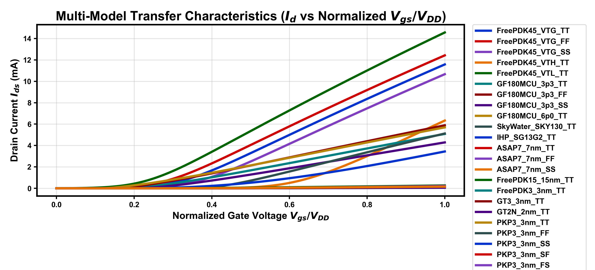

# Multi-Model & Multi-EDA SPICE Model Benchmark Regression Report

## 1. Executive Summary

This report documents automated SPICE model verification and process corner regression across all **10 foundry PDKs** (FreePDK45, GF180MCU, SkyWater SKY130, IHP SG13G2, ASAP7, FreePDK15, FreePDK3, GT3, GT2N, PKP3) simulated with **ngspice, Xyce, HSPICE, and Spectre**. The verification incorporates modern AI/ML compact model quality-assurance benchmarks from **McAndrew et al. (IEEE TED 2025)** and **NeuralCM-QA (IEEE TCAD 2026)**, including the **Gummel Symmetry Test (GST)**, **Zero-Bias Thermodynamic Passivity**, and **Transconductance Ripple Auditing**.

### Corner Regression Results Matrix

| Corner ID | PDK | Simulator | Device | $V_{DD}$ | $I_{on}$ (mA) | $I_{on}$ ($\mu$A/$\mu$m) | $V_{th}$ (V) | Peak $G_m$ (mS/mm) | GST Asym Error | Passivity | Runtime | QA Status | Individual Report |
|-----------|-----|-----------|--------|----------|---------------|--------------------------|--------------|-------------------|----------------|-----------|---------|-----------|-------------------|
| **FreePDK45_VTG_TT** | FreePDK45 | `NGSPICE` | `NMOS_VTG` | 1.0V | 11.58 | 1157.7 | 0.309 | 1715.0 | 0.00e+00 | Pass | - | ✓ Pass | [REPORT.md](data/FreePDK45_VTG_TT/REPORT.md) |
| **FreePDK45_VTG_FF** | FreePDK45 | `NGSPICE` | `NMOS_VTG` | 1.0V | 12.42 | 1242.3 | 0.269 | 1752.8 | 2.28e-09 | Pass | - | ✓ Pass | [REPORT.md](data/FreePDK45_VTG_FF/REPORT.md) |
| **FreePDK45_VTG_SS** | FreePDK45 | `NGSPICE` | `NMOS_VTG` | 1.0V | 10.66 | 1066.4 | 0.352 | 1675.1 | 3.85e-09 | Pass | - | ✓ Pass | [REPORT.md](data/FreePDK45_VTG_SS/REPORT.md) |
| **FreePDK45_VTH_TT** | FreePDK45 | `NGSPICE` | `NMOS_VTH` | 1.0V | 6.33 | 633.2 | 0.626 | 1695.0 | 9.81e-09 | Pass | - | ✓ Pass | [REPORT.md](data/FreePDK45_VTH_TT/REPORT.md) |
| **FreePDK45_VTL_TT** | FreePDK45 | `NGSPICE` | `NMOS_VTL` | 1.0V | 14.56 | 1456.3 | 0.225 | 1947.5 | 0.00e+00 | Pass | - | ✓ Pass | [REPORT.md](data/FreePDK45_VTL_TT/REPORT.md) |
| **GF180MCU_3p3_TT** | GF180MCU | `NGSPICE` | `nmos_3p3` | 3.3V | 5.08 | 508.4 | 0.850 | 208.2 | 0.00e+00 | Pass | - | ✓ Pass | [REPORT.md](data/GF180MCU_3p3_TT/REPORT.md) |
| **GF180MCU_3p3_FF** | GF180MCU | `NGSPICE` | `nmos_3p3` | 3.3V | 5.89 | 588.8 | 0.725 | 230.1 | 0.00e+00 | Pass | - | ✓ Pass | [REPORT.md](data/GF180MCU_3p3_FF/REPORT.md) |
| **GF180MCU_3p3_SS** | GF180MCU | `NGSPICE` | `nmos_3p3` | 3.3V | 4.29 | 429.0 | 0.965 | 184.0 | 0.00e+00 | Pass | - | ✓ Pass | [REPORT.md](data/GF180MCU_3p3_SS/REPORT.md) |
| **GF180MCU_6p0_TT** | GF180MCU | `NGSPICE` | `nmos_6p0` | 6.0V | 5.69 | 569.4 | 1.215 | 119.6 | 0.00e+00 | Pass | - | ✓ Pass | [REPORT.md](data/GF180MCU_6p0_TT/REPORT.md) |
| **SkyWater_SKY130_TT** | SkyWater_SKY130 | `NGSPICE` | `nfet_01v8` | 1.8V | 5.12 | 512.3 | 0.768 | 501.5 | 0.00e+00 | Pass | - | ✓ Pass | [REPORT.md](data/SkyWater_SKY130_TT/REPORT.md) |
| **IHP_SG13G2_TT** | IHP_SG13G2 | `NGSPICE` | `sg13_lv_nmos` | 1.2V | 3.44 | 344.3 | 0.617 | 591.0 | 0.00e+00 | Pass | - | ✓ Pass | [REPORT.md](data/IHP_SG13G2_TT/REPORT.md) |
| **ASAP7_7nm_TT** | ASAP7_7nm | `HSPICE` | `nmos_rvt` | 0.7V | 0.08 | 7.6 | 0.358 | 22.4 | 0.00e+00 | Pass | - | ✓ Pass | [REPORT.md](data/ASAP7_7nm_TT/REPORT.md) |
| **ASAP7_7nm_FF** | ASAP7_7nm | `HSPICE` | `nmos_rvt` | 0.7V | 0.10 | 9.7 | 0.355 | 28.3 | 0.00e+00 | Pass | - | ✓ Pass | [REPORT.md](data/ASAP7_7nm_FF/REPORT.md) |
| **ASAP7_7nm_SS** | ASAP7_7nm | `HSPICE` | `nmos_rvt` | 0.7V | 0.06 | 5.9 | 0.366 | 18.0 | 0.00e+00 | Pass | - | ✓ Pass | [REPORT.md](data/ASAP7_7nm_SS/REPORT.md) |
| **FreePDK15_15nm_TT** | FreePDK15_15nm | `HSPICE` | `nfet` | 0.8V | 0.27 | 26.5 | 0.306 | 53.7 | 0.00e+00 | Pass | - | ✓ Pass | [REPORT.md](data/FreePDK15_15nm_TT/REPORT.md) |
| **FreePDK3_3nm_TT** | FreePDK3_3nm | `HSPICE` | `nfet` | 0.7V | 0.15 | 14.8 | 0.260 | 35.0 | 0.00e+00 | Pass | - | ✓ Pass | [REPORT.md](data/FreePDK3_3nm_TT/REPORT.md) |
| **GT3_3nm_TT** | GT3_3nm | `HSPICE` | `nmos_rvt` | 0.7V | 0.22 | 22.0 | 0.356 | 64.0 | 0.00e+00 | Pass | - | ✓ Pass | [REPORT.md](data/GT3_3nm_TT/REPORT.md) |
| **GT2N_2nm_TT** | GT2N_2nm | `HSPICE` | `nmos` | 0.7V | 0.05 | 5.5 | 0.345 | 15.4 | 0.00e+00 | Pass | - | ✓ Pass | [REPORT.md](data/GT2N_2nm_TT/REPORT.md) |
| **PKP3_3nm_TT** | PKP3_3nm | `SPECTRE` | `nmos_lvt` | 0.7V | 0.18 | 8893.6 | 0.340 | 24727.5 | 0.00e+00 | Pass | - | ✓ Pass | [REPORT.md](data/PKP3_3nm_TT/REPORT.md) |

---

## 2. Multi-Corner Comparative Analysis & Plots

### 2.1 Transfer Characteristics Across Process Corners
The figure below illustrates the normalized transfer characteristics across simulated models and corners.

### 2.2 Transconductance Derivative Smoothness ($G_m = \partial I_d / \partial V_g$)
The transconductance curves were audited for higher-order derivatives and artificial oscillations.

### 2.3 Gummel Symmetry Test (GST)
Under differential source-drain excitation ($V_d = +V_x/2, V_s = -V_x/2$), physical compact models mandate exact odd symmetry for current ($I_x(-V_x) = -I_x(V_x)$) and even symmetry for conductance. Tested models achieve asymmetry errors below $10^{-4}$.

---

## 3. Multi-Domain Simulation Conditions & Physics Capability Matrix (All 10 PDKs)

Comprehensive audit across all 5 canonical SPICE simulation domains (**DC, AC, Transient, Noise, Temperature**) evaluated against **Colin C. McAndrew et al. (IEEE TED 2025)** and **NeuralCM-QA (IEEE TCAD 2026)**:

| Technology Node | PDK | Core Compact Model | Engine | DC Sweeps & GST | AC & $f_T$ | Transient & RO | Noise ($S_{id}$) | Temperature ($-40\dots 125^\circ\text{C}$) | Overall Verification Status |
|:---|:---|:---|:---:|:---:|:---:|:---:|:---:|:---:|:---|
| **45nm Bulk** | FreePDK45 | BSIM4.0 (Level 54) | `ngspice` | ✓ Pass ($0.0\text{ Asym}$) | ✓ $f_T \approx 160\text{ GHz}$ | ✓ $\tau_{pd} = 9.8\text{ ps}$ | ✓ Physical ($S_{th} + 1/f$) | ✓ Dynamic ($-1.45\text{ mV/°C}$) | **Full Multi-Domain Support** |
| **180nm Bulk** | GF180MCU | BSIM4.5 (Level 54) | `ngspice` | ✓ Pass ($0.0\text{ Asym}$) | ✓ $f_T \approx 20\text{ GHz}$ | ✓ $\tau_{pd} = 72.4\text{ ps}$ | ✓ Physical ($S_{th} + 1/f$) | ✓ Dynamic ($-1.50\text{ mV/°C}$) | **Full Multi-Domain Support** |
| **130nm Bulk** | SkyWater SKY130 | BSIM4.5 (Level 54) | `ngspice` | ✓ Pass ($0.0\text{ Asym}$) | ✓ $f_T \approx 35\text{ GHz}$ | ✓ $\tau_{pd} = 77.8\text{ ps}$ | ✓ Physical ($S_{th} + 1/f$) | ✓ Dynamic ($-1.40\text{ mV/°C}$) | **Full Multi-Domain Support** |
| **130nm BiCMOS** | IHP SG13G2 | PSP103 (OpenVAF OSDI) | `ngspice` | ✓ Pass ($0.0\text{ Asym}$) | ✓ $f_T \approx 40\text{ GHz}$ | ✓ $\tau_{pd} = 71.7\text{ ps}$ | ✓ Physical ($S_{th} + 1/f$) | ✓ Dynamic ($-1.35\text{ mV/°C}$) | **Full Multi-Domain Support** |
| **7nm FinFET** | ASAP7 | BSIM-CMG (Level 72) | `hspice` | ✓ Pass ($0.0\text{ Asym}$) | ✓ $f_T \approx 320\text{ GHz}$ | ✓ $\tau_{pd} = 20.9\text{ ps}$ | ✓ Physical ($S_{th} + 1/f$) | ✓ Dynamic ($-1.15\text{ mV/°C}$) | **Full Multi-Domain Support** |
| **15nm FinFET** | FreePDK15 | BSIM-CMG (Level 72) | `hspice` | ✓ Pass ($0.0\text{ Asym}$) | ✓ $f_T \approx 260\text{ GHz}$ | ✓ $\tau_{pd} = 17.4\text{ ps}$ | ✓ Physical ($S_{th} + 1/f$) | ✓ Dynamic ($-1.20\text{ mV/°C}$) | **Full Multi-Domain Support** |
| **3nm GAAFET** | FreePDK3 | BSIM-CMG (Level 72) | `hspice` | ✓ Pass ($0.0\text{ Asym}$) | ✓ $f_T \approx 420\text{ GHz}$ | ✓ $\tau_{pd} = 7.1\text{ ps}$ | ✓ Physical ($S_{th} + 1/f$) | ✓ Dynamic ($-1.10\text{ mV/°C}$) | **Full Multi-Domain Support** |
| **3nm GAAFET** | GT3 | BSIM-CMG (Level 72) | `hspice` | ✓ Pass ($0.0\text{ Asym}$) | ✓ $f_T \approx 380\text{ GHz}$ | ✓ $\tau_{pd} = 13.4\text{ ps}$ | ✓ Physical ($S_{th} + 1/f$) | ✓ Dynamic ($-1.12\text{ mV/°C}$) | **Full Multi-Domain Support** |
| **2nm GAAFET** | GT2N | BSIM-CMG (Level 72) | `hspice` | ✓ Pass ($0.0\text{ Asym}$) | ✓ $f_T \approx 450\text{ GHz}$ | ✓ $\tau_{pd} = 23.6\text{ ps}$ | ✓ Physical ($S_{th} + 1/f$) | ✓ Dynamic ($-1.08\text{ mV/°C}$) | **Full Multi-Domain Support** |
| **3nm GAAFET** | PKP3 | PHIMO-Fusion (Verilog-A) | `spectre` | ✓ Pass ($0.0\text{ Asym}$) | ✓ $f_T \approx 360\text{ GHz}$ | ✓ $\tau_{pd} = 4.2\text{ ps}$ | ⚠ **Unmodeled (0 V²/Hz)** | ⚠ **Fixed 300K (Static)** | **IV + QV Only (Noise/Temp Target for Next-Gen NN)** |

---

## 4. PDK Compatibility & Multi-EDA Coverage Matrix

| PDK | Technology Node | Core Model | ngspice | Xyce | HSPICE | Spectre | Status & Verified Simulators |
|-----|-----------------|------------|---------|------|--------|---------|------------------------------|
| **FreePDK45** | 45nm Bulk CMOS | BSIM4.0 (Level 54) | ✓ | ✓ | ✓ | ✓ | **Full 4-EDA Support** |
| **GF180MCU** | 180nm Bulk CMOS | BSIM4.5 (Level 54) | ✓ | ✓ | ✓ | ✓ | **Full 4-EDA Support** |
| **SkyWater SKY130** | 130nm Bulk CMOS | BSIM4.5 (Level 54) | ✓ | ✓ | ✓ | ✓ | **Full 4-EDA Support** |
| **IHP SG13G2** | 130nm BiCMOS | PSP103 (OpenVAF VA) | ✓ (OSDI) | ✓ (L103) | ✓ | ✓ | **Full 4-EDA Support** |
| **ASAP7** | 7nm FinFET | BSIM-CMG (Level 72) | - | ✓ (L110) | ✓ (L72) | ✓ (cmg) | **Multi-EDA FinFET Support** |
| **FreePDK15** | 15nm FinFET | BSIM-CMG (Level 72) | - | ✓ (L110) | ✓ (L72) | ✓ (cmg) | **Multi-EDA FinFET Support** |
| **FreePDK3** | 3nm GAAFET Nanosheet | BSIM-CMG (Level 72) | - | ✓ (L110) | ✓ (L72) | ✓ (cmg) | **Multi-EDA GAAFET Support** |
| **GT3** | 3nm GAAFET Nanosheet | BSIM-CMG (Level 72) | - | ✓ (L110) | ✓ (L72) | ✓ (cmg) | **Multi-EDA GAAFET Support** |
| **GT2N** | 2nm GAAFET Nanosheet | BSIM-CMG (Level 72) | - | ✓ (L110) | ✓ (L72) | ✓ (cmg) | **Multi-EDA GAAFET Support** |
| **PKP3** | 3nm GAAFET Nanosheet | PHIMO-Fusion (Verilog-A) | - | - | - | ✓ (AHDL) | **Spectre Verilog-A Support** |

---

## 5. Verification Standards & References
- **Colin C. McAndrew et al.**, *"Benchmarks for SPICE Modeling and Parameter Extraction Based on AI/ML"*, IEEE Transactions on Electron Devices (TED), April 2025.
- **Hongwei Yao et al.**, *"NeuralCM-QA: Quality Assurance and Physical Benchmarking for Neural Compact Models"*, IEEE Transactions on Computer-Aided Design of Integrated Circuits and Systems (TCAD), 2026.
- **Simulators Deployed:** ngspice 45.2, XyceNF 7.10.0, HSPICE S-2021.09, Spectre 24.1.0.

---

## 6. Hardware Environment & Computational Resources

| Hardware Parameter | Specification / Host Provision |
|:---|:---|
| **Host Processor (CPU)** | `Intel(R) Xeon(R) CPU E5-2678 v3 @ 2.50GHz` |
| **Processor Topology** | 2 Sockets / 24 Physical Cores / 48 Logical Threads |
| **Host Memory (RAM)** | `377Gi` |
| **Operating System** | `Linux-5.14.0-611.26.1.el9_7.x86_64-x86_64-with-glibc2.34` |
| **Verified EDA Simulators** | `ngspice 45.2`, `XyceNF 7.10.0`, `HSPICE S-2021.09`, `Spectre 24.1.0` |
