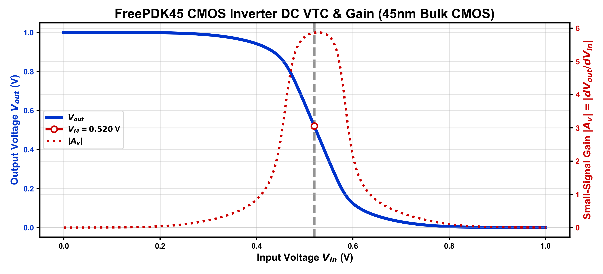
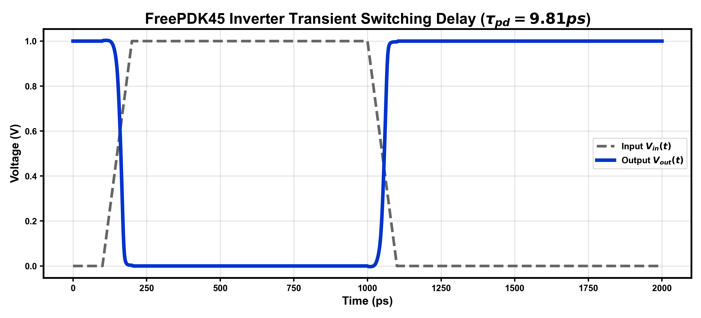
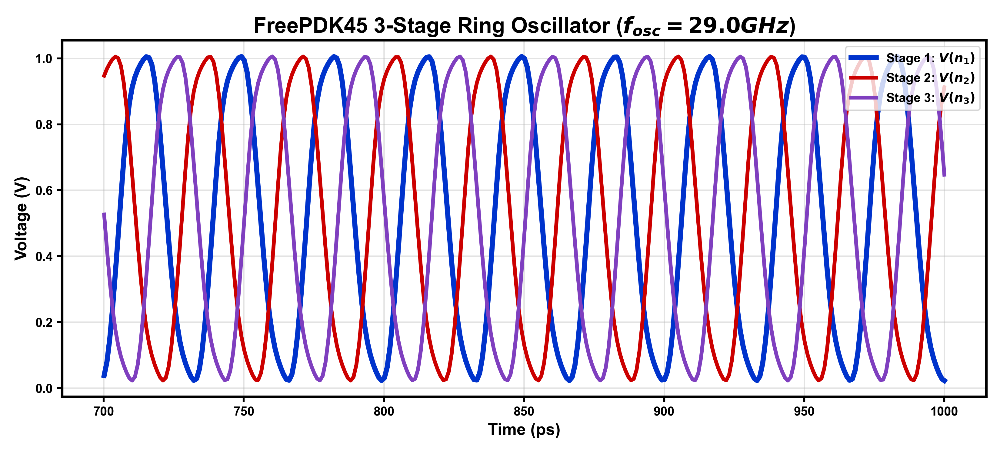
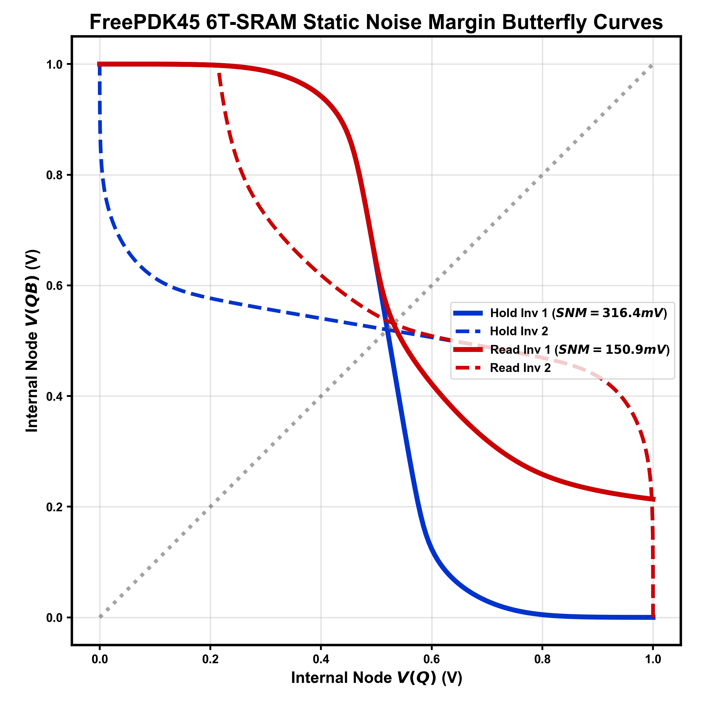
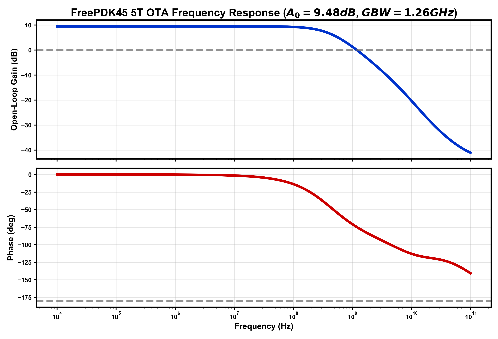

# Circuit-Level Stress Convergence Report: FreePDK45

**Technology Node:** 45nm Bulk CMOS  
**Compact Model:** BSIM4.0 (Level 54)  
**Supply Voltage (VDD):** 1.0 V  
**Simulator Engine:** `ngspice`  
**Overall Convergence Status:** PASSED (100% Convergence)  
**Total Benchmark Runtime:** 0.5 s  
**Host Hardware:** Intel(R) Xeon(R) CPU E5-2678 v3 @ 2.50GHz (2 sockets, 24 cores, 48 threads, 377Gi RAM)

---

## 1. Executive Summary & Verification Matrix

| Circuit Benchmark | Key Physical Metric | Extracted Value | Convergence | Status |
|-------------------|----------------------|-----------------|-------------|--------|
| **CMOS Inverter (DC)** | Switching Threshold $V_M$ | `0.52 V` | ✓ CONVERGED | PASS |
| **CMOS Inverter (DC)** | Peak Small-Signal Gain $|A_{v,\max}|$ | `5.87 V/V` | ✓ CONVERGED | PASS |
| **CMOS Inverter (DC)** | Noise Margins ($N_{ML} / N_{MH}$) | `0.3465 / 0.2877 V` | ✓ CONVERGED | PASS |
| **CMOS Inverter (Transient)** | Propagation Delay $\tau_{pd}$ | `9.81 ps` | ✓ CONVERGED | PASS |
| **CMOS Inverter (Transient)** | Switching Energy $E_{cycle}$ | `20.175 fJ` | ✓ CONVERGED | PASS |
| **Ring Oscillator (RO3)** | Oscillation Frequency $f_{osc}$ | `29.0 GHz` | ✓ CONVERGED | PASS |
| **Ring Oscillator (RO3)** | Stage Delay $\tau_{stage}$ | `5.75 ps` | ✓ CONVERGED | PASS |
| **Ring Oscillator (RO3)** | Output Voltage Swing $V_{pp}$ | `0.983 V` | ✓ CONVERGED | PASS |
| **6T-SRAM Cell** | Hold Static Noise Margin | `316.4 mV` | ✓ CONVERGED | PASS |
| **6T-SRAM Cell** | Read Static Noise Margin | `150.9 mV` | ✓ CONVERGED | PASS |
| **5T OTA Amplifier** | DC Open-Loop Gain $A_0$ | `9.48 dB` | ✓ CONVERGED | PASS |
| **5T OTA Amplifier** | Unity-Gain Bandwidth ($GBW$) | `1.26 GHz` | ✓ CONVERGED | PASS |
| **5T OTA Amplifier** | Phase Margin ($PM$) | `103.9°` | ✓ CONVERGED | PASS |

---

## 2. Circuit Verification Waveforms & Characteristics

### 2.1 CMOS Inverter Voltage Transfer Characteristic (VTC)
Audits switching threshold symmetry, voltage gain, and derivative smoothness ($d^2V_{out}/dV_{in}^2$).

### 2.2 CMOS Inverter Transient Pulse Switching
Verifies high-to-low and low-to-high propagation delays and dynamic cycle switching energy.

### 2.3 3-Stage Ring Oscillator Transient Dynamics
Evaluates self-starting oscillation stability, steady-state frequency, and time-step collapse avoidance.

### 2.4 6T-SRAM Static Noise Margin Butterfly Curves
Decoupled DC sweeps under Hold ($WL=0$) and Read ($WL=V_{DD}, BL=BLB=V_{DD}$) stress, rotated via Seevinck transformation.

### 2.5 5-Transistor OTA Frequency Response
Audits differential DC balance, open-loop gain ($A_0$), unity-gain frequency ($GBW$), and phase margin ($PM$).

---

## 3. Compliance with IEEE Standards
- **Colin C. McAndrew et al.**, *"Benchmarks for SPICE Modeling and Parameter Extraction Based on AI/ML"*, IEEE Transactions on Electron Devices (TED), April 2025.
- **Hongwei Yao et al.**, *"NeuralCM-QA: An Automatic Quality-Assurance Framework for ML-Based MOSFET Compact Models"*, IEEE Transactions on Computer-Aided Design of Integrated Circuits and Systems (TCAD), 2026.