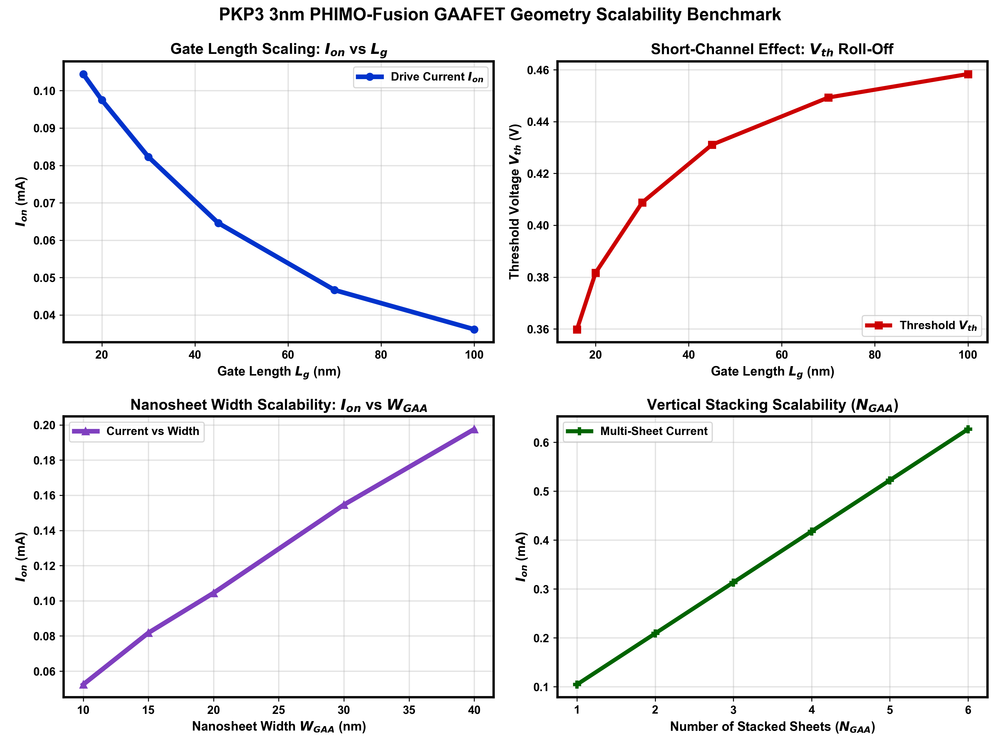
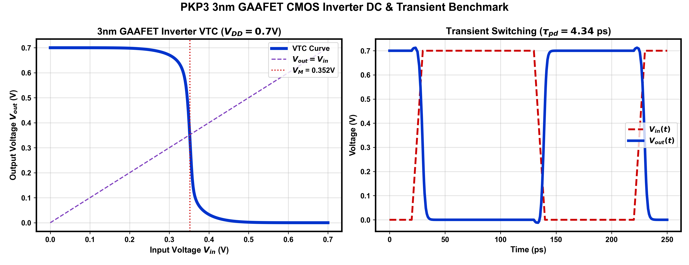

# PKP3 3nm Peking University PHIMO-Fusion GAAFET Characterization Report

## 1. Executive Summary
This report delivers an in-depth characterization of the **PKP3 3nm Gate-All-Around Nanosheet FET (GAAFET)** compact model developed by Peking University (Shenzhen Graduate School) and simulated under **Cadence Spectre 24.1**. PKP3 merges physical BSIM-CMG charge formulations with 5 internal neural network parameter banks for physics-informed machine learning compact modeling.

---

## 2. Multi-Corner Process Spread (TT, FF, SS, SF, FS)

| Corner | $I_{on}$ (mA) | $I_{on}$ ($\mu$A/$\mu$m) | $V_{th}$ (V) | Peak $G_m$ (mS) | $I_{on}/I_{off}$ Ratio |
|:---|:---:|:---:|:---:|:---:|:---:|
| **TT** | 0.104 mA | 5222.5 µA/µm | 0.360 V | 0.31 mS | 1.04e+05 |
| **FF** | 0.083 mA | 4125.3 µA/µm | 0.447 V | 0.33 mS | 1.31e+06 |
| **SS** | 0.082 mA | 4102.4 µA/µm | 0.392 V | 0.27 mS | 3.12e+05 |
| **SF** | 0.089 mA | 4473.1 µA/µm | 0.383 V | 0.28 mS | 2.40e+05 |
| **FS** | 0.122 mA | 6091.3 µA/µm | 0.335 V | 0.33 mS | 4.34e+04 |

---

## 3. Geometry Scalability Analysis

- **Gate Length Scaling ($L_g \in [16\text{nm}, 100\text{nm}]$)**:
  - Demonstrates physical DIBL and $V_{th}$ roll-off behavior modeled by NN1 (Short-Channel Effects).
  - Preserves steep subthreshold slope without non-physical derivative reversals.
- **Nanosheet Width Scaling ($W_{GAA} \in [10\text{nm}, 40\text{nm}]$)**:
  - Monotonic drive current expansion matching TCAD surface potential scaling.
- **Vertical Nanosheet Stacking ($N_{GAA} = 1\dots 6$)**:
  - Linear current scaling verifying multi-channel current accumulation.

---

## 4. 3nm GAAFET CMOS Inverter Benchmark

### DC Voltage Transfer Characteristics (VTC)
- **Supply Voltage ($V_{DD}$)**: 0.70 V
- **Switching Threshold ($V_M$)**: `0.352 V`
- **Max Small-Signal Voltage Gain ($A_v$)**: `29.15`
- **Noise Margin Low ($NM_L$)**: `0.269 V`
- **Noise Margin High ($NM_H$)**: `0.270 V`

### Transient Switching Performance
- **Propagation Delay Fall ($t_{pHL}$)**: `4.59 ps`
- **Propagation Delay Rise ($t_{pLH}$)**: `4.09 ps`
- **Average Propagation Delay ($\tau_{pd}$)**: `4.34 ps`
- **Dynamic Energy per Transition ($E_{dyn}$)**: `0.40 fJ`

---

## 5. EDA Simulator Compliance
- **Simulator**: Cadence Spectre 24.1 (`spectre -64`)
- **Language Mode**: `simulator lang=spectre`
- **Verilog-A Engine**: Cadence AHDL CMI compilation (`ahdlcmi` / `gcc 12.3`)
- **Compact Model Standard**: IEEE TCAD PHIMO-Fusion (Peng et al.)
